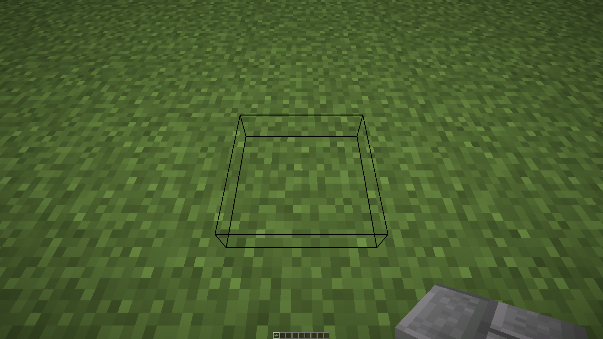

# Microblocks

Cut any block into pieces as small as **1/16 of a block** and put as many pieces as you like into one block space. Build with slabs 1 pixel thick, sticks 2 pixels wide, windows, shutters, shingles, beams, flower boxes, lanterns, railings, hinges: shapes that no stair or slab has.

Every piece is a real box with its own material, so one block space can hold a stone plinth, an oak post, a glass pane and a brass handle at once. It all renders like an ordinary block: smooth lighting, ambient occlusion, works with Sodium, works on OpenGL and Vulkan.

*The roof is made of shingles 4/16 deep and 3/16 high, so the slope is far finer than a stair or slab can do. Plinth, walls, beams, windows with frames and shutters, planters, lanterns and the path: all microblocks.*

## What you can build

*A gatehouse with battered base, corbelled towers, merlons, arrow slits, a round arch with a raised portcullis and banners.*

*An arched bridge: every slice of the arch is its own box.*

*A market stall with a striped awning, fruit trays, barrels, a well with a roof, flower beds and lamp posts.*

## Shapes

Three shapes (plane, stick, cube) in the standard sizes 1/16, 1/8, 1/4 and 1/2, plus any other size you cut on the table.

*A table with 2/16 legs, a chair, a shelf with books and a lamp.*

## Placing

* **Free placement with snapping**, like directional blocks: the piece snaps to the face you look at.
* **Auto rotation**: the long side lies along the nearest edge, the thin side to the surface. To turn it yourself, use the item in the air.
* **Preview**: a black outline shows exactly where the piece will go before you place it.
* Several pieces share one block space; overlapping pieces are refused, touching ones are fine.
* In the hand, in a slot and on the ground you see the **real 3D model** of the piece, not a flat texture.

## Microblock Table

A special block. Put a block or a microblock in, choose the axis (X / Y / Z) and the sixteenth, press *Cut it*: you get the two pieces. Cut as often as you want, down to 1/16.

## Blueprints and prefabs

Right-click a block of microblocks with **vanilla paper** to make a **blueprint** of it. On the table, put the blueprint and the materials: the table works out how many prefabs the material volume gives and returns the leftover as planes.

A **prefab** places the whole build at once, anywhere. In the world it is shown as a translucent blue ghost with black outlines of its parts; in the hand and in a slot it is the real model in blue.

## More pictures

## Details

* Greedy meshing inside a block space: neighbouring pieces of one material merge into one face, so a big build stays light.
* Works with **Sodium**: the pieces are part of the chunk mesh, not an entity.
* Works with the Vulkan backend (checked on the newest version).
* Creative tab with the table and the standard shapes of sample materials.
* `/microblock give <block> <a> <b> <c> [count]` gives a piece of any size, in sixteenths.

## Supported versions

Minecraft **1.18.2 to 26.3** (26.1 and 26.1.1 are skipped).

| Versions | Loaders |
|---|---|
| 1.18.2, 1.19.2, 1.19.4, 1.20.1 | Fabric, Forge |
| 1.20.4 | Fabric |
| 1.21 to 26.3 | Fabric, NeoForge |

## Requires

* **Aki Lib** (the shared library of my mods)
* Architectury API
* Fabric API on Fabric

The pictures were made with the mod's own scenes on a flat world.
